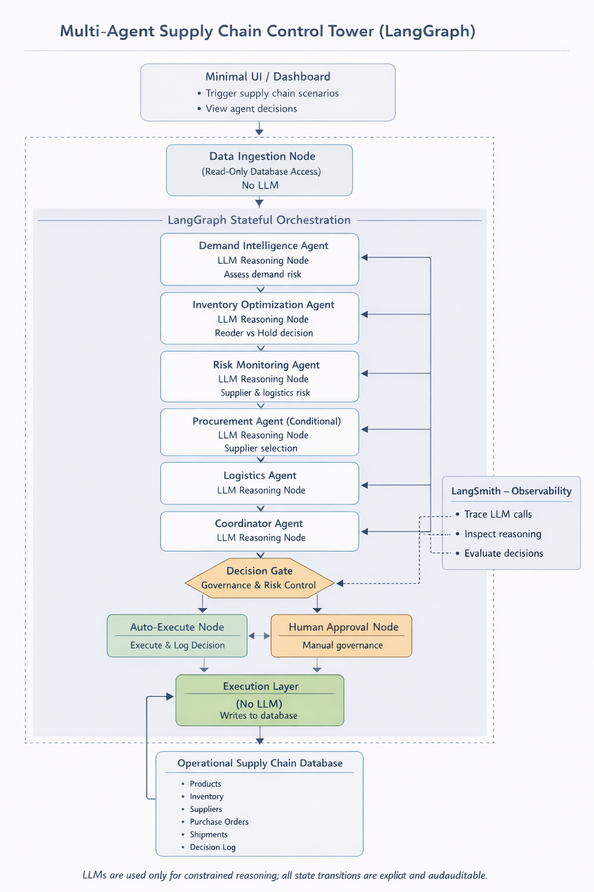

# ChainMind AI
### Multi-Agent Intelligence for Supply Chain Decision-Making

<p align="center">
  An explainable, LangGraph-powered supply chain control tower that coordinates specialized AI agents to analyze demand, inventory, supplier risk, and logistics decisions.
</p>

<p align="center">
  
  
  
  
  
</p>

---

## Overview

Supply chain operations involve interconnected decisions about demand fluctuations, inventory replenishment, supplier reliability, and shipment delays. Handling these decisions independently can make it difficult to assess operational risks and coordinate appropriate responses.

**ChainMind AI** is a multi-agent decision-support system that brings these responsibilities into a coordinated workflow. Specialized AI agents analyze different aspects of a supply chain, while a central coordinator synthesizes their findings into a final recommendation.

The workflow is orchestrated using **LangGraph** and incorporates risk-based decision routing and human approval checkpoints to make the decision process more transparent.

## Key Features

- **Multi-Agent Architecture:** Dedicated agents for demand analysis, inventory management, supplier and operational risk, and logistics.
- **Centralized Decision Coordination:** Combines agent outputs into a consolidated supply chain recommendation.
- **LangGraph Orchestration:** Connects data ingestion, analysis, decision routing, approval, and execution through a structured workflow.
- **Risk-Based Decision Gates:** Routes decisions according to their assessed risk.
- **Human-in-the-Loop Governance:** Supports approval or rejection checkpoints for decisions requiring human oversight.
- **Interactive Streamlit Dashboard:** Displays inventory conditions, supplier information, purchase orders, shipments, agent reasoning, and final decisions.
- **Persistent Demo Database:** Uses SQLite and SQLAlchemy to manage supply chain entities and operational state.
- **LLM Integration:** Uses LangChain's chat model interface with OpenRouter for model-powered reasoning.
- **Optional Observability:** Supports LangSmith tracing when configured.

## System Architecture



### Decision Workflow

1. **Data Ingestion:** Loads the current supply chain snapshot from the database.
2. **Specialized Agent Analysis:** Demand, inventory, risk, and logistics agents evaluate the available information.
3. **Decision Coordination:** The coordinator synthesizes the individual agent outputs into a final recommendation.
4. **Risk Assessment:** A decision gate determines whether the workflow can proceed automatically or requires human approval.
5. **Human Approval:** Decisions requiring oversight are routed through an approval checkpoint.
6. **Execution:** The execution node processes permitted actions and records the resulting status.
7. **Dashboard Visualization:** The Streamlit interface presents the operational state, agent reasoning, and decision outcome.

## Technology Stack

| Component | Technologies |
|---|---|
| Language | Python |
| Agent orchestration | LangGraph |
| LLM integration | LangChain, langchain-openai, OpenRouter |
| Frontend | Streamlit |
| Database | SQLite, SQLAlchemy, aiosqlite |
| Data validation | Pydantic |
| Environment management | python-dotenv |
| Observability | Optional LangSmith tracing |

## Project Structure

```text
ChainMind-AI/
├── demo/
│   └── demo.py
├── src/
│   ├── agents/
│   │   ├── coordinator_agent.py
│   │   ├── demand_agent.py
│   │   ├── inventory_agent.py
│   │   ├── logistics_agent.py
│   │   └── risk_agent.py
│   ├── nodes/
│   │   ├── data_ingestion.py
│   │   ├── decision_gate.py
│   │   ├── execution.py
│   │   └── human_approval.py
│   ├── backend_interface.py
│   ├── db_init.py
│   ├── db_service.py
│   ├── graph.py
│   ├── llm_config.py
│   ├── main.py
│   ├── models.py
│   └── state.py
├── ui/
│   ├── app.py
│   ├── helpers.py
│   └── arch_diagram.png
├── .env.example
├── .gitignore
├── requirements.txt
└── README.md
```

## Getting Started

### Prerequisites

- Python 3.12 or a compatible Python version
- Git
- An OpenRouter API key for LLM-powered operations

### 1. Clone the repository

```bash
git clone https://github.com/jeeninub/ChainMind-AI.git
cd ChainMind-AI
```

### 2. Create a virtual environment

**Windows PowerShell**

```powershell
python -m venv .venv
.\.venv\Scripts\Activate.ps1
```

**macOS / Linux**

```bash
python3 -m venv .venv
source .venv/bin/activate
```

### 3. Install dependencies

```bash
python -m pip install --upgrade pip
pip install -r requirements.txt
pip install streamlit
```

### 4. Configure environment variables

Create a local `.env` file by copying the example template.

**Windows PowerShell**

```powershell
Copy-Item .env.example .env
```

**macOS / Linux**

```bash
cp .env.example .env
```

Update `.env` with your own credentials:

```dotenv
OPENROUTER_API_KEY=your_openrouter_api_key
OPENROUTER_MODEL=openai/gpt-4o-mini

DATABASE_URL=sqlite:///data/supply_chain.db

# Optional LangSmith tracing
LANGCHAIN_TRACING_V2=false
LANGCHAIN_API_KEY=
LANGCHAIN_PROJECT=chainmind-ai
```

Keep `.env` private. Never commit API keys, access tokens, or other credentials to GitHub.

### 5. Launch the dashboard

From the project root, run:

```bash
streamlit run ui/app.py
```

Streamlit will display a local URL, usually:

```text
http://localhost:8501
```

Open the URL in your browser to access the control tower.

### 6. Run the backend workflow

To initialize the demo data and execute the backend decision cycle:

```bash
python -m src.main
```

The backend entry point initializes the database, seeds example supply chain records, and runs the decision workflow.

## Using the Dashboard

The dashboard lets you:

- Select a product for analysis.
- Trigger a supply chain decision cycle.
- Inspect inventory levels and reorder thresholds.
- Review supplier reliability and lead times.
- View active purchase orders and shipments.
- Examine the reasoning produced by individual agents.
- Review the consolidated recommendation and governance status.

## Governance and Limitations

ChainMind AI is an educational decision-support prototype, not a production supply chain platform.

- The included database and operational records are intended for demonstration.
- Model recommendations depend on the available data, prompts, and selected LLM.
- Human approval checkpoints provide a governance mechanism; they do not guarantee that every decision is correct.
- External enterprise integrations, live logistics feeds, production authentication, and deployment infrastructure are not included by default.
- Validate recommendations before using them to make real operational or financial decisions.

## Future Enhancements

- Integrate real-time supplier, shipment, and demand data.
- Add scenario simulation for demand spikes, supplier outages, and logistics disruptions.
- Introduce automated evaluation and regression testing for agent decisions.
- Add role-based access control and audit logging.
- Extend observability with detailed traces and performance metrics.
- Deploy the dashboard with managed secrets and persistent storage.

## Author

**Sujal Jain**  
B.Tech. Computer Science and Engineering  
The LNM Institute of Information Technology

- GitHub: [@jeeninub](https://github.com/jeeninub)
- Project Repository: [ChainMind-AI](https://github.com/jeeninub/ChainMind-AI)
- LinkedIn: [Sujal Jain](https://www.linkedin.com/in/sujal-jain-1a483627b/)

---

*Built to explore explainable multi-agent AI workflows for operational decision support.*
