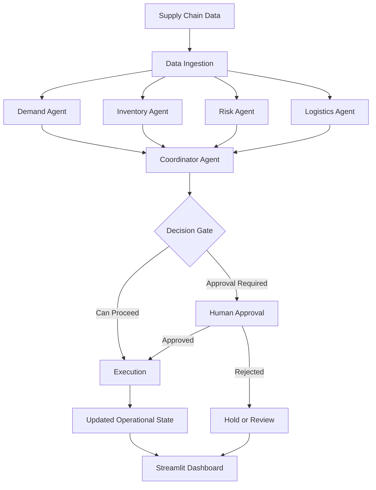

# ChainMind AI

### Multi-Agent Intelligence for Supply Chain Decision-Making

<p align="center">
  
  
  
  
  
</p>

<p align="center">
  A multi-agent AI control tower that analyzes supply chain operations, identifies risks, and coordinates intelligent decisions across demand, inventory, and logistics.
</p>

---

## Overview

Supply chain management requires coordinated decisions across demand forecasting, inventory availability, supplier reliability, and logistics operations. When these functions operate in isolation, identifying risks and responding to disruptions becomes more difficult.

**ChainMind AI** is a multi-agent decision-support system designed to coordinate specialized AI agents within a structured workflow. Each agent focuses on a particular operational responsibility, while a central coordinator combines their findings into a consolidated recommendation.

Built with **Python, LangChain, and LangGraph**, the system demonstrates how agent-based reasoning, workflow orchestration, risk-based decision routing, and human approval checkpoints can work together in a supply chain environment.

## Key Features

- **Multi-Agent Architecture:** Specialized agents for demand analysis, inventory management, risk assessment, logistics, and decision coordination.
- **Centralized Decision Coordination:** Consolidates individual agent outputs into a unified supply chain recommendation.
- **LangGraph Workflow Orchestration:** Connects data ingestion, agent analysis, decision routing, approval, and execution.
- **Risk-Based Decision Gates:** Routes decisions through workflow checkpoints based on assessed risk.
- **Human-in-the-Loop Approval:** Supports human review for decisions requiring additional oversight.
- **Interactive Streamlit Dashboard:** Provides a visual interface for exploring supply chain information and decision outcomes.
- **Persistent Data Layer:** Uses SQLite and SQLAlchemy for storing and retrieving operational records.
- **LLM-Powered Reasoning:** Integrates chat models through LangChain and OpenRouter.
- **Modular Design:** Separates agents, workflow nodes, database services, and the user interface for easier maintenance and extension.

## System Architecture

The application is organized into four main layers:

1. **Data Layer:** Stores supply chain records and provides database access.
2. **Agent Layer:** Performs demand, inventory, logistics, and risk analysis.
3. **Orchestration Layer:** Coordinates agent execution and manages decision and approval checkpoints.
4. **Presentation Layer:** Displays operational data and workflow results through Streamlit.

### Workflow



## Technology Stack

| Component | Technology |
|---|---|
| Programming Language | Python |
| Agent Orchestration | LangGraph |
| LLM Integration | LangChain, OpenRouter |
| User Interface | Streamlit |
| Database | SQLite |
| ORM / Database Access | SQLAlchemy |
| Async Database Access | aiosqlite |
| Data Validation | Pydantic |
| Environment Configuration | python-dotenv |
| Optional Observability | LangSmith |

## Project Structure

```text
ChainMind-AI/
├── demo/
│   └── demo.py
├── src/
│   ├── agents/
│   │   ├── coordinator_agent.py
│   │   ├── demand_agent.py
│   │   ├── inventory_agent.py
│   │   ├── logistics_agent.py
│   │   └── risk_agent.py
│   ├── nodes/
│   │   ├── data_ingestion.py
│   │   ├── decision_gate.py
│   │   ├── execution.py
│   │   └── human_approval.py
│   ├── backend_interface.py
│   ├── db_init.py
│   ├── db_service.py
│   ├── graph.py
│   ├── llm_config.py
│   ├── main.py
│   ├── models.py
│   └── state.py
├── ui/
│   ├── app.py
│   ├── helpers.py
│   └── arch_diagram.png
├── .env.example
├── .gitignore
├── README.md
└── requirements.txt
```

## Getting Started

### Prerequisites

- Python installed on your system
- Git
- An OpenRouter API key for LLM-powered functionality

### 1. Clone the Repository

```bash
git clone https://github.com/jeeninub/ChainMind-AI.git
cd ChainMind-AI
```

### 2. Create a Virtual Environment

**Windows PowerShell**

```powershell
python -m venv .venv
.\.venv\Scripts\Activate.ps1
```

**macOS / Linux**

```bash
python3 -m venv .venv
source .venv/bin/activate
```

### 3. Install Dependencies

```bash
python -m pip install --upgrade pip
pip install -r requirements.txt
pip install streamlit
```

### 4. Configure Environment Variables

Create a local `.env` file from the provided template.

**Windows PowerShell**

```powershell
Copy-Item .env.example .env
```

**macOS / Linux**

```bash
cp .env.example .env
```

Update `.env` with your own API key and desired model:

```dotenv
OPENROUTER_API_KEY=your_openrouter_api_key
OPENROUTER_MODEL=openai/gpt-4o-mini
DATABASE_URL=sqlite:///data/supply_chain.db
```

Replace the placeholder with your own OpenRouter API key. Never commit `.env` or real credentials to GitHub.

### 5. Launch the Dashboard

From the repository root, run:

```bash
streamlit run ui/app.py
```

Open the local URL displayed by Streamlit, usually:

`http://localhost:8501`

### 6. Run the Backend Workflow

To run the backend entry point:

```bash
python -m src.main
```

The backend initializes the database and executes the configured supply chain workflow. The exact behavior depends on the current implementation and environment configuration.

## Application Use Cases

ChainMind AI is designed to demonstrate agent-based decision support for scenarios such as:

- Identifying inventory shortages and replenishment needs.
- Evaluating demand changes and operational constraints.
- Highlighting supplier and supply chain risks.
- Reviewing logistics-related issues.
- Coordinating recommendations from multiple specialized agents.
- Routing decisions for human review before execution.

These are intended use cases; actual outputs depend on the configured data, agent logic, and selected LLM.

## Governance and Limitations

ChainMind AI is an educational prototype for exploring multi-agent AI workflows. It is not a production-ready enterprise supply chain platform.

- Recommendations depend on data quality and model outputs.
- LLM-generated decisions may be incomplete or incorrect.
- Human approval checkpoints provide oversight but do not guarantee correctness.
- Live enterprise integrations, production authentication, and managed deployment infrastructure are not included by default.
- Validate recommendations before applying them to real supply chain operations.

## Future Enhancements

- Integrate live inventory, supplier, and shipment data.
- Add demand forecasting and disruption scenario simulation.
- Introduce automated evaluation and regression testing for agent decisions.
- Add role-based access control and detailed audit trails.
- Improve observability with workflow traces and performance metrics.
- Deploy the dashboard with secure secret management and persistent storage.

## Author

**Sujal Jain**  
B.Tech. Computer Science and Engineering  
The LNM Institute of Information Technology

- **GitHub:** [jeeninub](https://github.com/jeeninub)
- **Project:** [ChainMind-AI](https://github.com/jeeninub/ChainMind-AI)
- **LinkedIn:** [Sujal Jain](https://www.linkedin.com/in/sujal-jain-1a483627b/)

---

<p align="center">
  Built to explore multi-agent AI, workflow orchestration, and intelligent supply chain decision support.
</p>
# ChainMind AI

### Multi-Agent Intelligence for Supply Chain Decision-Making

<p align="center">
  
  
  
  
  
</p>

<p align="center">
  A multi-agent AI control tower that analyzes supply chain operations, identifies risks, and coordinates intelligent decisions across demand, inventory, and logistics.
</p>

---

## Overview

Supply chain management requires coordinated decisions across demand forecasting, inventory availability, supplier reliability, and logistics operations. When these functions operate in isolation, identifying risks and responding to disruptions becomes more difficult.

**ChainMind AI** is a multi-agent decision-support system designed to coordinate specialized AI agents within a structured workflow. Each agent focuses on a particular operational responsibility, while a central coordinator combines their findings into a consolidated recommendation.

Built with **Python, LangChain, and LangGraph**, the system demonstrates how agent-based reasoning, workflow orchestration, risk-based decision routing, and human approval checkpoints can work together in a supply chain environment.

## Key Features

- **Multi-Agent Architecture:** Specialized agents for demand analysis, inventory management, risk assessment, logistics, and decision coordination.
- **Centralized Decision Coordination:** Consolidates individual agent outputs into a unified supply chain recommendation.
- **LangGraph Workflow Orchestration:** Connects data ingestion, agent analysis, decision routing, approval, and execution.
- **Risk-Based Decision Gates:** Routes decisions through workflow checkpoints based on assessed risk.
- **Human-in-the-Loop Approval:** Supports human review for decisions requiring additional oversight.
- **Interactive Streamlit Dashboard:** Provides a visual interface for exploring supply chain information and decision outcomes.
- **Persistent Data Layer:** Uses SQLite and SQLAlchemy for storing and retrieving operational records.
- **LLM-Powered Reasoning:** Integrates chat models through LangChain and OpenRouter.
- **Modular Design:** Separates agents, workflow nodes, database services, and the user interface for easier maintenance and extension.

## System Architecture

The application is organized into four main layers:

1. **Data Layer:** Stores supply chain records and provides database access.
2. **Agent Layer:** Performs demand, inventory, logistics, and risk analysis.
3. **Orchestration Layer:** Coordinates agent execution and manages decision and approval checkpoints.
4. **Presentation Layer:** Displays operational data and workflow results through Streamlit.

### Workflow


## Technology Stack

| Component | Technology |
|---|---|
| Programming Language | Python |
| Agent Orchestration | LangGraph |
| LLM Integration | LangChain, OpenRouter |
| User Interface | Streamlit |
| Database | SQLite |
| ORM / Database Access | SQLAlchemy |
| Async Database Access | aiosqlite |
| Data Validation | Pydantic |
| Environment Configuration | python-dotenv |
| Optional Observability | LangSmith |

## Project Structure

```text
ChainMind-AI/
├── demo/
│   └── demo.py
├── src/
│   ├── agents/
│   │   ├── coordinator_agent.py
│   │   ├── demand_agent.py
│   │   ├── inventory_agent.py
│   │   ├── logistics_agent.py
│   │   └── risk_agent.py
│   ├── nodes/
│   │   ├── data_ingestion.py
│   │   ├── decision_gate.py
│   │   ├── execution.py
│   │   └── human_approval.py
│   ├── backend_interface.py
│   ├── db_init.py
│   ├── db_service.py
│   ├── graph.py
│   ├── llm_config.py
│   ├── main.py
│   ├── models.py
│   └── state.py
├── ui/
│   ├── app.py
│   ├── helpers.py
│   └── arch_diagram.png
├── .env.example
├── .gitignore
├── README.md
└── requirements.txt
```

## Getting Started

### Prerequisites

- Python installed on your system
- Git
- An OpenRouter API key for LLM-powered functionality

### 1. Clone the Repository

```bash
git clone https://github.com/jeeninub/ChainMind-AI.git
cd ChainMind-AI
```

### 2. Create a Virtual Environment

**Windows PowerShell**

```powershell
python -m venv .venv
.\.venv\Scripts\Activate.ps1
```

**macOS / Linux**

```bash
python3 -m venv .venv
source .venv/bin/activate
```

### 3. Install Dependencies

```bash
python -m pip install --upgrade pip
pip install -r requirements.txt
pip install streamlit
```

### 4. Configure Environment Variables

Create a local `.env` file from the provided template.

**Windows PowerShell**

```powershell
Copy-Item .env.example .env
```

**macOS / Linux**

```bash
cp .env.example .env
```

Update `.env` with your own API key and desired model:

```dotenv
OPENROUTER_API_KEY=your_openrouter_api_key
OPENROUTER_MODEL=openai/gpt-4o-mini
DATABASE_URL=sqlite:///data/supply_chain.db
```

Replace the placeholder with your own OpenRouter API key. Never commit `.env` or real credentials to GitHub.

### 5. Launch the Dashboard

From the repository root, run:

```bash
streamlit run ui/app.py
```

Open the local URL displayed by Streamlit, usually:

`http://localhost:8501`

### 6. Run the Backend Workflow

To run the backend entry point:

```bash
python -m src.main
```

The backend initializes the database and executes the configured supply chain workflow. The exact behavior depends on the current implementation and environment configuration.

## Application Use Cases

ChainMind AI is designed to demonstrate agent-based decision support for scenarios such as:

- Identifying inventory shortages and replenishment needs.
- Evaluating demand changes and operational constraints.
- Highlighting supplier and supply chain risks.
- Reviewing logistics-related issues.
- Coordinating recommendations from multiple specialized agents.
- Routing decisions for human review before execution.

These are intended use cases; actual outputs depend on the configured data, agent logic, and selected LLM.

## Governance and Limitations

ChainMind AI is an educational prototype for exploring multi-agent AI workflows. It is not a production-ready enterprise supply chain platform.

- Recommendations depend on data quality and model outputs.
- LLM-generated decisions may be incomplete or incorrect.
- Human approval checkpoints provide oversight but do not guarantee correctness.
- Live enterprise integrations, production authentication, and managed deployment infrastructure are not included by default.
- Validate recommendations before applying them to real supply chain operations.

## Future Enhancements

- Integrate live inventory, supplier, and shipment data.
- Add demand forecasting and disruption scenario simulation.
- Introduce automated evaluation and regression testing for agent decisions.
- Add role-based access control and detailed audit trails.
- Improve observability with workflow traces and performance metrics.
- Deploy the dashboard with secure secret management and persistent storage.

## Author

**Sujal Jain**  
B.Tech. Computer Science and Engineering  
The LNM Institute of Information Technology

- **GitHub:** [jeeninub](https://github.com/jeeninub)
- **Project:** [ChainMind-AI](https://github.com/jeeninub/ChainMind-AI)
- **LinkedIn:** [Sujal Jain](https://www.linkedin.com/in/sujal-jain-1a483627b/)

---

<p align="center">
  Built to explore multi-agent AI, workflow orchestration, and intelligent supply chain decision support.
</p>
