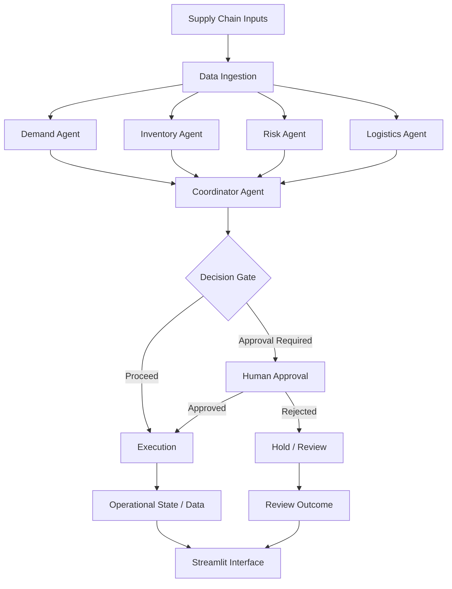

# ChainMind AI
### A Multi-Agent AI Control Tower for Intelligent Supply Chain Decision-Making

<p align="center">
  
  
  
  
  
</p>

<p align="center">
  <b>From fragmented supply chain signals to coordinated, AI-assisted decisions.</b>
</p>

<p align="center">
  <a href="https://github.com/jeeninub/ChainMind-AI">Repository</a> •
  <a href="#-system-architecture">Architecture</a> •
  <a href="#-getting-started">Getting Started</a> •
  <a href="#-roadmap">Roadmap</a>
</p>

---

## Overview

Modern supply chains involve interconnected decisions across demand, inventory, logistics, and operational risk. A change in one area can affect several others: a demand surge may create inventory shortages, while a logistics disruption may delay replenishment and increase operational risk.

**ChainMind AI** is a multi-agent supply chain decision-support system that brings these responsibilities together through a coordinated AI workflow.

The project uses specialized agents to analyze different aspects of supply chain operations and a coordinator to consolidate their outputs. LangGraph structures the workflow, decision gates route the process, and human approval checkpoints introduce oversight before designated actions proceed.

A Streamlit interface provides the application entry point, while SQLite supports persistent data storage. OpenRouter provides access to configurable language models for AI-powered reasoning.

The goal is to demonstrate how a modular, multi-agent architecture can support supply chain analysis and structured decision-making rather than relying on a single, general-purpose AI assistant.

### At a Glance

| Component | Description |
|---|---|
| Project Type | Multi-agent AI decision-support application |
| Primary Domain | Supply chain operations |
| Agent Responsibilities | Demand, inventory, logistics, risk, and coordination |
| Workflow Engine | LangGraph |
| LLM Integration | LangChain and OpenRouter |
| User Interface | Streamlit |
| Data Storage | SQLite |
| Approval Mechanism | Human-in-the-loop workflow checkpoints |
| Primary Language | Python |

## Problem Statement

Supply chain operations generate multiple signals that must be evaluated together. Demand patterns, inventory levels, transportation constraints, and operational risks are closely related, but analyzing them independently can lead to incomplete decisions.

Traditional dashboards can display operational information, but interpreting the information and coordinating the next steps may still require manual effort.

ChainMind AI explores an alternative approach: **divide the analysis into specialized responsibilities, coordinate the results through a graph-based workflow, and introduce explicit decision checkpoints.**

### Challenges Addressed

- **Fragmented analysis:** Different operational concerns require different forms of analysis.
- **Cross-functional dependencies:** Inventory, demand, logistics, and risk assessments can influence one another.
- **Unstructured decision-making:** Individual observations need to be consolidated into actionable recommendations.
- **Uncontrolled execution:** Decisions may require review rather than automatically proceeding.
- **Limited workflow visibility:** A structured workflow helps make the sequence of analysis and decisions easier to understand.

## Project Objectives

1. Build a modular multi-agent system for supply chain decision support.
2. Separate domain-specific reasoning into specialized agents.
3. Coordinate agent execution through LangGraph.
4. Introduce decision gates and human approval checkpoints.
5. Support data persistence through SQLite and database services.
6. Provide a Streamlit interface for interacting with the application.
7. Keep the LLM configuration separate from the main workflow.
8. Establish a foundation for future integrations, evaluation, and production deployment.

## Key Features

### 1. Specialized AI Agents

The architecture separates supply chain responsibilities into dedicated agent modules.

- **Demand Agent:** Handles demand-related analysis.
- **Inventory Agent:** Handles inventory-related analysis.
- **Logistics Agent:** Handles logistics-related analysis.
- **Risk Agent:** Evaluates supply chain risk.
- **Coordinator Agent:** Brings agent outputs together to support consolidated decision-making.

This separation makes individual responsibilities easier to maintain, evaluate, and extend.

### 2. Graph-Based Workflow Orchestration

LangGraph provides the workflow structure for connecting ingestion, analysis, decision-making, approval, and execution stages.

Rather than treating the application as a single uninterrupted LLM call, the graph organizes the process into explicit nodes and transitions.

### 3. Risk-Aware Decision Routing

A dedicated decision gate introduces a control point within the workflow. This creates a structured location for determining how a proposed decision should proceed.

The exact routing behavior depends on the implemented decision logic and application state.

### 4. Human-in-the-Loop Approval

A separate human approval node supports a review checkpoint for decisions requiring oversight.

This design is intended to keep designated decisions from proceeding without the required approval. The approval behavior and persistence of pending decisions depend on the underlying implementation.

### 5. LLM Integration Through OpenRouter

The project separates model configuration into a dedicated module. OpenRouter credentials and model selection are configured through environment variables rather than hardcoded into the application.

This makes model configuration easier to change without embedding secrets in source files.

### 6. Persistent Data Layer

SQLite provides a lightweight relational database for application data. Dedicated database initialization and service modules separate storage-related responsibilities from the agent and interface layers.

### 7. Interactive Application Interface

The Streamlit application provides the user-facing entry point to the system. UI helpers are separated from the primary application file to keep presentation-related code organized.

### 8. Modular and Extensible Codebase

Agents, workflow nodes, graph orchestration, database services, state definitions, and UI components are separated into dedicated modules.

This structure provides a foundation for adding integrations, automated tests, monitoring, and more advanced workflow behavior.

---

## System Architecture

ChainMind AI follows a modular architecture with four main layers.

| Layer | Main Components | Responsibility |
|---|---|---|
| Data Layer | Database initialization, database services, models | Manage application data and database access |
| Agent Layer | Demand, inventory, logistics, risk, coordinator agents | Perform specialized analysis and consolidate findings |
| Orchestration Layer | LangGraph, state, workflow nodes | Coordinate processing, routing, approval, and execution |
| Presentation Layer | Streamlit application, UI helpers | Provide the application interface |

### Architecture Diagram

<p align="center">
  
</p>

*The architecture image is maintained in the `ui/` directory.*

### Workflow Overview



*Conceptual representation of the application's workflow. Actual node execution and routing are determined by the implementation.*

## How the Workflow Works

### Step 1 — Data Ingestion

The workflow begins at the data ingestion node, which prepares the relevant inputs for downstream processing.

The quality and structure of these inputs influence the usefulness of the subsequent analysis.

### Step 2 — Specialized Analysis

The system organizes analysis across four domain-specific agents:

- Demand analysis
- Inventory analysis
- Risk assessment
- Logistics analysis

Each agent focuses on its assigned responsibility rather than combining every concern into one component.

### Step 3 — Decision Coordination

The coordinator agent consolidates the available findings into a broader decision context.

This layer is important because a recommendation that considers only one operational dimension may overlook dependencies elsewhere in the supply chain.

### Step 4 — Decision Gate

The workflow reaches a dedicated decision gate. This node acts as a control point for routing the process according to the implemented decision criteria.

### Step 5 — Human Review

Where approval is required, the workflow can route the decision through the human approval node.

This provides a place for review before the designated execution step.

### Step 6 — Execution

The execution node handles the workflow's execution stage after the applicable routing and approval conditions are satisfied.

The precise external actions, if any, depend on the code and integrations configured in the project.

### Step 7 — Application Interface

The Streamlit interface provides the entry point for interacting with the application and viewing the information exposed by its implementation.

---

## Technology Stack

### Core Technologies

| Technology | Role in the Project |
|---|---|
| Python | Application logic and agent implementation |
| LangGraph | Graph-based workflow orchestration |
| LangChain | LLM integration framework |
| OpenRouter | Configurable language-model access |
| Streamlit | Interactive application interface |
| SQLite | Relational data persistence |
| SQLAlchemy | Database abstraction and ORM functionality |
| aiosqlite | Asynchronous SQLite access |
| Pydantic | Data validation and structured data models |
| python-dotenv | Environment variable configuration |
| LangSmith | Optional tracing and observability, if configured |

### Why These Technologies?

**Python** provides a common implementation language across the agents, workflow, database layer, and interface.

**LangGraph** makes the workflow explicit by representing processing stages and transitions as a graph.

**LangChain and OpenRouter** provide the integration layer for configurable LLM-powered reasoning.

**Streamlit** enables a Python-based interface without requiring a separate frontend application.

**SQLite and SQLAlchemy** provide a lightweight relational data layer suitable for local development and prototyping.

**Pydantic** supports structured data validation, while environment-based configuration keeps credentials separate from application code.

---

## Repository Structure

```text
ChainMind-AI/
│
├── demo/
│   └── demo.py
│
├── src/
│   ├── agents/
│   │   ├── __init__.py
│   │   ├── coordinator_agent.py
│   │   ├── demand_agent.py
│   │   ├── inventory_agent.py
│   │   ├── logistics_agent.py
│   │   └── risk_agent.py
│   │
│   ├── nodes/
│   │   ├── __init__.py
│   │   ├── data_ingestion.py
│   │   ├── decision_gate.py
│   │   ├── execution.py
│   │   └── human_approval.py
│   │
│   ├── __init__.py
│   ├── backend_interface.py
│   ├── db_init.py
│   ├── db_service.py
│   ├── graph.py
│   ├── llm_config.py
│   ├── main.py
│   ├── models.py
│   └── state.py
│
├── ui/
│   ├── app.py
│   ├── arch_diagram.png
│   └── helpers.py
│
├── .env.example
├── .gitignore
├── README.md
└── requirements.txt
```

### Important Modules

| Module | Purpose |
|---|---|
| `src/agents/` | Specialized agent implementations |
| `src/nodes/` | Workflow processing, decision gates, approval, and execution |
| `src/graph.py` | Graph-based workflow orchestration |
| `src/state.py` | Shared workflow state definitions |
| `src/models.py` | Application data models |
| `src/llm_config.py` | LLM configuration |
| `src/db_init.py` | Database initialization |
| `src/db_service.py` | Database service operations |
| `src/backend_interface.py` | Backend interface and integration layer |
| `src/main.py` | Backend entry point |
| `ui/app.py` | Streamlit application entry point |
| `ui/helpers.py` | UI-related helper functions |
| `demo/demo.py` | Demonstration entry point |
| `.env.example` | Environment variable template |
| `requirements.txt` | Python dependency definitions |

---

## Getting Started

Follow the instructions below to run the project locally.

### Prerequisites

Make sure you have:

- Python 3.12 or a compatible version supported by the dependencies.
- Git installed and available from your terminal.
- An OpenRouter API key for LLM-powered functionality.
- Internet connectivity when downloading dependencies or calling a hosted model.

### 1. Clone the Repository

```bash
git clone https://github.com/jeeninub/ChainMind-AI.git
cd ChainMind-AI
```

### 2. Create a Virtual Environment

A virtual environment keeps the project's dependencies isolated from other Python applications.

**Windows PowerShell**

```powershell
python -m venv .venv
.\.venv\Scripts\Activate.ps1
```

If PowerShell blocks script execution, use Command Prompt instead:

```bat
.venv\Scripts\activate.bat
```

**macOS / Linux**

```bash
python3 -m venv .venv
source .venv/bin/activate
```

### 3. Install Dependencies

Upgrade pip and install the project's dependencies:

```bash
python -m pip install --upgrade pip
pip install -r requirements.txt
```

If Streamlit is not included in the dependency file, install it separately:

```bash
pip install streamlit
```

### 4. Configure Environment Variables

Copy the example environment file to create your local configuration.

**Windows PowerShell**

```powershell
Copy-Item .env.example .env
```

**macOS / Linux**

```bash
cp .env.example .env
```

Open `.env` and configure the required values:

```dotenv
OPENROUTER_API_KEY=your_openrouter_api_key
OPENROUTER_MODEL=openai/gpt-4o-mini
DATABASE_URL=sqlite:///data/supply_chain.db
```

Replace the API key placeholder with your own valid OpenRouter API key.

The model value shown above is an example configuration. Use a model available to your OpenRouter account and supported by the application's LLM configuration.

**Security note:** Never commit your real `.env` file or API credentials to GitHub. The repository's `.gitignore` excludes environment files while allowing `.env.example` to be tracked.

### 5. Launch the Streamlit Application

From the repository root:

```bash
streamlit run ui/app.py
```

Streamlit should display a local URL in your terminal, typically:

```text
http://localhost:8501
```

Open that URL in your browser to access the local application.

### 6. Run the Backend Entry Point

The backend entry point can be invoked from the repository root:

```bash
python -m src.main
```

This command runs the configured backend entry point. The actual processing performed depends on the implementation and environment configuration.

### 7. Run the Demonstration

The repository also contains a demonstration script:

```bash
python demo/demo.py
```

Use this entry point to explore the demonstration workflow. Its exact behavior and prerequisites are determined by the script.

---

## Configuration Reference

The `.env.example` file documents the primary configuration variables.

| Variable | Purpose | Example |
|---|---|---|
| `OPENROUTER_API_KEY` | Authenticates requests to OpenRouter | `your_openrouter_api_key` |
| `OPENROUTER_MODEL` | Selects the configured LLM | `openai/gpt-4o-mini` |
| `DATABASE_URL` | Configures the database connection | `sqlite:///data/supply_chain.db` |

### Configuration Recommendations

- Keep credentials in `.env`, not in Python source files.
- Use `.env.example` to communicate the required configuration to other developers.
- Avoid committing database files or generated local data.
- Verify that the configured model is accessible through your OpenRouter account.
- Ensure the database path and database initialization logic are compatible with your local environment.

---

## Engineering Design Principles

### Separation of Responsibilities

Agent logic, workflow nodes, persistence, configuration, and presentation are separated into distinct modules.

This reduces unnecessary coupling and makes it easier to modify one part of the application without redesigning the entire system.

### Explicit Workflow Control

The graph-based workflow makes decision points visible in the application structure. Dedicated nodes for decision routing and human approval provide clearer boundaries between analysis and execution.

### Configurable Model Integration

LLM configuration is isolated from the agent and workflow modules. This creates a cleaner path for changing model settings without spreading configuration logic across the codebase.

### Lightweight Persistence

SQLite offers a straightforward way to persist application data during local development. The separate database initialization and service modules provide a starting point for more advanced storage requirements.

### Extensibility

The modular agent architecture provides a foundation for additional specialized agents, external data connectors, automated evaluations, and improved observability.

---

## Potential Use Cases

ChainMind AI can serve as a foundation for exploring AI-assisted decision support in scenarios such as:

- **Demand analysis:** Examine changes in demand-related inputs.
- **Inventory planning:** Evaluate inventory-related concerns.
- **Logistics analysis:** Review transportation and logistics constraints.
- **Risk identification:** Organize supply chain risk assessments.
- **Decision coordination:** Consolidate findings from different operational perspectives.
- **Approval workflows:** Introduce human review before designated decisions proceed.
- **Workflow experimentation:** Study how specialized agents can cooperate within a graph-based process.

These are potential application areas, not claims of measured business outcomes or verified production performance.

---

## Reliability, Security, and Limitations

ChainMind AI is a development and demonstration project. Its recommendations should not be treated as guaranteed operational decisions.

### Reliability

- LLM-generated outputs can be incomplete, inconsistent, or incorrect.
- Results depend on the quality of inputs and the implementation of each agent.
- The workflow should be tested against expected and unexpected inputs.
- Agent outputs should be validated before being used for consequential decisions.

### Human Oversight

Human approval checkpoints provide a mechanism for reviewing designated decisions. They do not independently guarantee that a recommendation is correct or that every execution path requires approval.

### Security

- API keys should remain outside version control.
- Production use would require appropriate authentication, authorization, and secret management.
- Sensitive operational data should be handled according to applicable security requirements.

### Production Readiness

Before using the application in a live supply chain environment, additional work may be needed for automated testing, error handling, audit trails, monitoring, access control, resilient database management, and integration with actual operational systems.

---

## Roadmap

The following are potential future enhancements, not features claimed to be implemented.

- [ ] Connect live inventory, supplier, and shipment data sources.
- [ ] Add dedicated demand forecasting and scenario simulation.
- [ ] Introduce structured evaluation of agent recommendations.
- [ ] Add automated unit and integration tests for workflow nodes.
- [ ] Improve retry handling and recovery from failed model requests.
- [ ] Add detailed execution logs and decision audit trails.
- [ ] Extend human approval with persistent review states.
- [ ] Introduce role-based access control where required.
- [ ] Add workflow tracing and operational monitoring.
- [ ] Deploy the application with secure configuration and persistent storage.

---

## Contributing

Contributions and suggestions are welcome.

1. Fork the repository.
2. Create a feature branch.
3. Make your changes and add appropriate tests.
4. Verify the application and workflow behavior.
5. Submit a pull request describing the changes.

For substantial changes, consider opening an issue first to discuss the proposed functionality.

## License

No license has been specified in this repository. Unless a license is added, the project should not be assumed to grant general permission to redistribute or reuse its code.

## Author

**Sujal Jain**  
B.Tech. in Computer Science and Engineering  
The LNM Institute of Information Technology

- **GitHub:** [@jeeninub](https://github.com/jeeninub)
- **Project Repository:** [ChainMind AI](https://github.com/jeeninub/ChainMind-AI)
- **LinkedIn:** [Sujal Jain](https://www.linkedin.com/in/sujal-jain-1a483627b/)

---

<p align="center">
  <b>Exploring multi-agent AI, graph-based orchestration, and intelligent supply chain decision support.</b>
</p>
